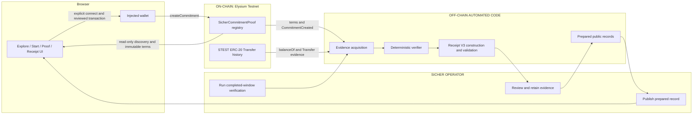

# Sicher Architecture

## Scope

This document describes the system currently deployed on Elysium Testnet. It separates deployed contracts, deterministic off-chain code, and steps performed by a Sicher operator.

## System view

## Component boundaries

### On-chain

`SicherCommitmentProof` stores:

- commitment ID;
- creator;
- subject;
- token;
- minimum balance;
- start block; and
- end block.

It emits `CommitmentCreated`. It does not read historical balances, compute a verdict, generate a receipt, enforce a future start, or prevent duplicate terms.

STEST provides the conventional ERC-20 `Transfer` history used by the frozen evidence process. This architecture does not generalize that accounting assumption to arbitrary tokens.

### Off-chain automated code

- Browser-side validation and transaction construction.
- Read-only registry discovery using a single `nextCommitmentId` snapshot and bounded commitment reads.
- Provider RPC acquisition and deterministic range coverage.
- Evidence normalization, deduplication, and ordering.
- Balance reconstruction in integer base units.
- Assurance and finality gates.
- Receipt V3 construction, canonical digesting, and validation.
- Frozen frontend-data preparation and validation.

“Automated code” describes what the software does when invoked. It does not mean the end-to-end post-window workflow is autonomously scheduled.

### Current human operations

- Detecting that a window is ready for final verification.
- Selecting and running the configured verifier workflow.
- Reviewing failures and retained evidence.
- Generating and validating Receipt V3 artifacts.
- Preparing and publishing the public frontend records.

## A. Creating a commitment

1. The browser reads the public Elysium head and passively reads wallet account/chain state.
2. The user explicitly connects the wallet if needed.
3. The user supplies subject, minimum, start block, and end block. V1 fixes the token to STEST.
4. The browser requires a nonzero subject, positive minimum, start strictly after the fresh head, and end after start.
5. The browser constructs a zero-value call to `createCommitment` on the canonical registry.
6. It performs `eth_call`, gas estimation, native gas-balance checking, and fee discovery.
7. Immediately before send, it rechecks account and chain.
8. Only the explicit submit action can invoke `eth_sendTransaction`.
9. A successful receipt must include the matching `CommitmentCreated` event, followed by registry readback.

The deployed contract independently rejects zero subject, zero token, zero minimum, and `endBlock <= startBlock`. Future-start enforcement exists only in the frontend.

## B. Verifying a completed commitment

1. Read commitment terms from registry storage through each configured provider.
2. Require provider agreement on chain and terms.
3. Read the subject's starting balance at `startBlock - 1`.
4. Acquire incoming and outgoing STEST `Transfer` logs for every deterministic inclusive range.
5. Normalize and compare the relevant evidence across configured providers.
6. Validate each discovered relevant event against its transaction receipt.
7. Check finality and consequential block hashes.
8. Apply ordered transfers to reconstruct the balance path.
9. Compare every reconstructed balance with the committed minimum.
10. Return the result and assurance separately.

For fixed accepted inputs, the reconstruction is deterministic. Completeness still depends on the configured evidence model and shared chain infrastructure.

## Event ordering

Events are sorted lexicographically by:

1. `blockNumber`
2. `transactionIndex`
3. `logIndex`

The ordering is required because multiple balance-changing transfers can occur within one block or transaction. Duplicate event keys are deduplicated; conflicting duplicates are rejected. Outgoing transfers subtract, incoming transfers add, and a self-transfer has zero net effect.

## C. Publishing a receipt

1. The verifier constructs a Receipt V3 envelope containing terms, result, balances, evidence references, assurance, limitations, and fingerprints.
2. Canonical serialization omits the receipt-digest field while computing its SHA-256 digest.
3. The exported validator checks schema and digest integrity.
4. Frontend-data preparation additionally binds the record to frozen evidence, implementation fingerprints, and approved path provenance.
5. The operator publishes the prepared record.
6. The browser loads and renders the prepared record; it does not recompute or upgrade the verdict.

Receipt files are editable local/public files. Their digest is tamper-evident when compared with an expected value, but the receipt is not signed or anchored on-chain.

## Dynamic Explore lifecycle

Explore obtains existence and immutable terms from the canonical registry. During one load it verifies the chain, reads the head, snapshots `nextCommitmentId` once, and reads the resulting finite ID range with bounded concurrency. A malformed or partial registry read fails the complete live view rather than appearing as zero commitments.

The prepared public receipt dataset is a separate enrichment source. A terminal result is used only when its ID, creator, subject, token, minimum, and block range agree with the registry record. Without a matching published receipt, the head determines only `Scheduled`, `Proof running`, or `Awaiting result`; it never determines `PROVEN`, `NOT_PROVEN`, or `CORROBORATED`.

## Fail-closed behavior

A terminal result is withheld when required evidence is missing, malformed, wrong-chain, incomplete, inconsistent, not finalized, or disagrees across required sources. Depending on the condition, the result remains `PENDING` or becomes `INDETERMINATE`. Missing data never implies `PROVEN`.

The frontend follows the same boundary: malformed or unavailable prepared records do not fall back to a positive commitment.

## Deployment identifiers

| Item | Value |
| --- | --- |
| Chain | Elysium Testnet |
| Chain ID | `99801` |
| Registry | `0x4e4887e28a8370678a9a37c08a85c65450b510c0` |
| STEST | `0x14fc373Dce148766a3B8d9C2BF5f02F8dbe316a7` |

## Further technical records

- [`COMPETITION_VERIFIER_FREEZE.md`](COMPETITION_VERIFIER_FREEZE.md)
- [`COMPETITION_ASSURANCE_POLICY.md`](COMPETITION_ASSURANCE_POLICY.md)
- [`TRUST_BOUNDARY.md`](TRUST_BOUNDARY.md)
- [`FRONTEND_INTEGRATION_CONTRACT.md`](FRONTEND_INTEGRATION_CONTRACT.md)
- [`transfer-event-ordering.md`](transfer-event-ordering.md)
